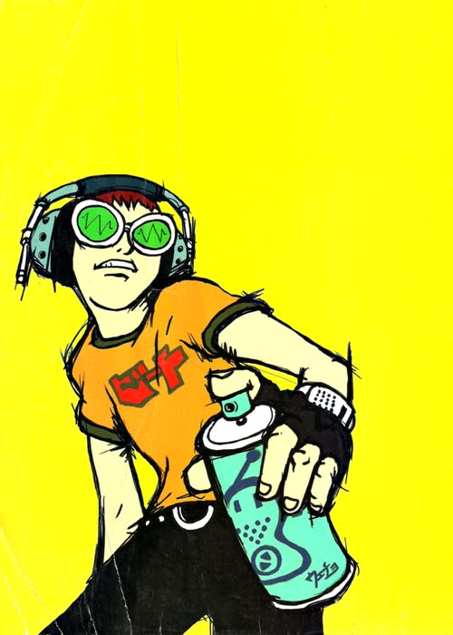

# About Me

Heyo! My name is Daniel Ballesteros. I study at the University of Washington.

This is not me... obviously.

This is a character from Jet Set Radio Future! Check it out at [this link](https://en.wikipedia.org/wiki/Jet_Set_Radio_Future).

## Academics

I am majoring in Computer Science and minoring in Technical and Professional Communication.

## Not Academics

I personally love playing video games. A few I'm into right now are:

- Old School Runescape
- Risk of Rain 2
- Animal Crossing

I'm also into learning guitar, rock climbing, running, and cooking. If I had to rank how good I was at these things from 1-10, it'd probably look like this:

| Hobby |  Level |
|-------:|-------|
| Games | 8 |
| Climbing | 6 |
| Guitar | 4 |
| Running | 3 |
| Cooking | 5 |

My favorite quote of all time comes from the movie "Tenet", where Neil says

> "What's happened happened, which is an expression of faith in the mechanics of the world, not an excuse to do nothing."